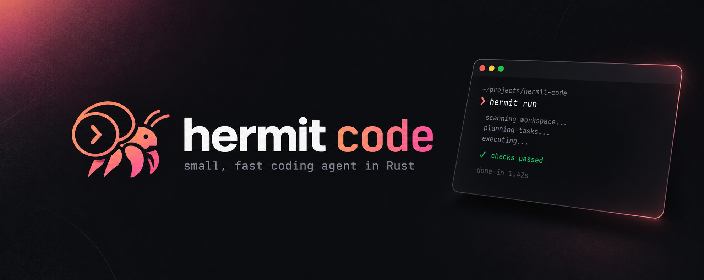

<p align="center">
  
</p>

# hermit code

A small, fast coding agent written in Rust. It talks to any OpenAI-compatible model, defaulting to **free OpenRouter models**. It reads and edits files, runs shell commands, and **checks that the code works**: after it makes changes, it runs your build and tests, and if they fail it sends the failures back to the model until they pass.

- Single ~4 MB binary, about 4–5 MB peak memory (on a single-threaded tokio runtime)
- Streams responses and retries with backoff. If a free model stays rate-limited, it switches to a fallback model for the rest of the session
- Tool output is capped (head and tail are kept). Long conversations are summarized by the model so recent context stays word for word
- Clean terminal UI: plain ANSI, no TUI framework. Replies stream live and are rendered as Markdown (headings, bold, code blocks, lists, and tables that fit the terminal width)
- Plan mode: read-only investigation that ends in a plan you approve before anything changes
- Sub-agents: the model hands broad codebase searches to a read-only `explore` helper with its own context, so the main conversation stays small
- Images: paste a screenshot with Ctrl+V or drag in an image file. Turns with images go to a model that can read them
- Plans multi-step work with a live todo list, remembers project facts in `HERMIT.md`, and saves every session so you can resume it
- Works with models that lack native tool calling (it switches to text-based tool calls automatically)

```
  █ █ █▀▀ █▀█ █▀▄▀█ █ ▀█▀  v0.1.0
  █▀█ ██▄ █▀▄ █ ▀ █ █  █   small, fast coding agent

  model   poolside/laguna-s-2.1:free
  dir     ~/repos/demo
  verify  cargo check --all-targets --quiet && cargo test --quiet

❯ fix the failing test

● Grep fn add
  └ 1 match
● Edit src/lib.rs
  └ src/lib.rs +1 -1
    -pub fn add(a: i32, b: i32) -> i32 { a - b }
    +pub fn add(a: i32, b: i32) -> i32 { a + b }
● Run cargo test --quiet
  │ test result: ok. 1 passed; 0 failed
  └ exit code 0
◆ Fixed `add`: it subtracted instead of adding. Tests pass.
● Verify cargo check --all-targets --quiet && cargo test --quiet
  ✓ checks passed
── 5 steps · 876 tokens · 8.9s
```

## Install

hermit runs on **macOS** (Apple Silicon and Intel) and **Linux** (x86_64 and ARM64). Windows isn't supported.

```sh
curl -fsSL https://raw.githubusercontent.com/Dhanush-K-Gowda/hermit-code/main/install.sh | sh
export OPENROUTER_API_KEY=sk-or-...   # free key: https://openrouter.ai/keys
hermit
```

The script downloads the prebuilt binary for your platform from the [latest release](https://github.com/Dhanush-K-Gowda/hermit-code/releases/latest), checks its SHA-256 checksum, and installs it to `~/.local/bin`. If that folder isn't on your `PATH`, it tells you how to add it. The Linux binaries are fully static, so they work on any distro. Options:

```sh
curl -fsSL …/install.sh | HERMIT_VERSION=v0.1.0 sh               # a specific version
curl -fsSL …/install.sh | HERMIT_INSTALL_DIR=/usr/local/bin sh   # another location (may need sudo)
```

**Update:** run the same command again. **Uninstall:** `rm ~/.local/bin/hermit` (and `rm -rf ~/.config/hermit` to remove config, memory and sessions).

**From source** (requires [Rust](https://rustup.rs)):

```sh
cargo install --git https://github.com/Dhanush-K-Gowda/hermit-code
# or, from a clone: cargo install --path . --force
```

## Usage

```sh
hermit                                   # interactive REPL in the current directory
hermit -p "make the failing tests pass"  # one-shot; exit 0 = done/verified, 2 = checks failing
hermit -C ../other-repo -m google/gemma-4-31b-it:free
hermit --yolo -p "..."                   # never ask before running commands
hermit --verify "make lint test" -p "..."
hermit --no-verify
hermit -c                                # continue the latest session in this directory
hermit --resume 1760234512-a1b2          # resume a specific session
hermit --text-tools -m some/model:free   # force text-based tool calls
hermit --plan -p "how would you add auth?"  # plan only; nothing is changed
```

### In the REPL

Paste an image with **Ctrl+V** (e.g. a screenshot taken with ⌘⇧⌃4), or drag an image file into the terminal. Either one becomes an `[Image #1]` placeholder in your message (details under [Images](#images)).

Type `/` to see every command as a gray suggestion. Keep typing to narrow it down: `/p` suggests `/plan [task|off]`. Press → or Tab to accept. Tab on `/` lists all commands, and Tab after `/model ` offers your configured models.

| Input | What it does |
|---|---|
| `fix the login bug` | Send a request to the agent |
| `!git status` | Run a shell command yourself. No approval prompt; the output is added to the conversation so the model can see it |
| `/model [id]` | Show or switch the model |
| `/models [all]` | List current free OpenRouter models: those with native tool calling, or `all`. Models that accept images are marked `(images)` |
| `/plan [task\|off]` | Plan mode: read-only, ends with a plan to approve (see below) |
| `/todo` | Show the agent's task list |
| `/remember <fact>` | Save a note to this project's `HERMIT.md` |
| `/memory` | Show saved project and user memory |
| `/sessions` | List saved sessions for this directory |
| `/resume [n\|id]` | Resume a session (default: the latest) |
| `/compact` | Summarize older context now |
| `/undo` | Revert file changes from the last turn |
| `/verify` | Run the project's checks, and have the model fix failures |
| `/clear` | Start a new conversation (the current one stays saved) |
| `/cost` | Token usage this session |
| `/exit` | Quit (Ctrl-D also works) |

End a line with `\` to continue on the next line. Ctrl-C cancels the running request or command; at an empty prompt, pressing Ctrl-C twice exits. `!` commands are non-interactive (no `vim` or `top`), and `!cd` doesn't carry over to the next command.

## Tools the model gets

`read_file`, `write_file`, `edit_file` (exact, unique string replace), `list_dir`, `glob`, `grep` (both respect `.gitignore`), `run_command`, `todo_write` (task checklist), `remember` (project memory), and `explore` (read-only sub-agent).

- Every path is confined to the workspace, and `..` or symlink escapes are rejected.
- File edits apply immediately and are shown as diffs. `/undo` reverts the last turn.
- Shell commands ask y/n unless they're on the allowlist of read, build and test commands (`cargo test`, `git diff`, `npm test`, …), or you answer `a` (always) for the session.

## Verification

When a turn changed files, hermit runs a check command:

| Project file | Command |
|---|---|
| `Cargo.toml` | `cargo check --all-targets --quiet && cargo test --quiet` |
| `go.mod` | `go build ./... && go test ./...` |
| `package.json` | `npm run build` / `tsc --noEmit` and `npm test` (when defined) |
| `pyproject.toml`, `pytest.ini`, `setup.py`, `tests/` | `python3 -m pytest -q -x` |
| `Makefile` with a `test:` target | `make test` |

If the check fails, the output goes back to the model, up to `max_fix_attempts` times.

## Planning, memory and sessions

**Plan mode.** Run `/plan` to toggle it, or `/plan <task>` to start straight away. The prompt changes to `plan ❯`. In plan mode:
- the model only gets read-only tools (read, list, glob, grep, todo)
- file writes and edits are refused, even if a text-mode model tries them anyway
- only read-only commands from the allowlist can run, so no formatters or `--fix`

The model investigates and ends with a concrete plan: the files to change, the changes, and how it will verify them. Then you're asked:

```
approve plan? [y] implement · [n] keep planning · or type feedback ›
```

`y` leaves plan mode and implements the plan, then the usual verify-and-fix loop runs. `n` stays in plan mode. Typing anything else sends it as feedback, and the model revises the plan. `hermit --plan -p "..."` prints a plan and exits; continue later with `hermit -c -p "go ahead"`.


**Sub-agents (`explore`).** For broad questions like "where is auth handled?", "how does a request flow through this?" or "what would this change touch?", the model can start an `explore` sub-agent on its own:
- the sub-agent gets a fresh context window and only read-only tools (read, list, glob, grep, and read-only commands)
- it can't edit files, write todos, save memory, or start more sub-agents
- only its final report, capped at 12 KB, goes back into the main conversation, so large searches don't fill your context
- it stops after 25 steps (when it reaches the limit, it's asked to report what it found)
- it works in plan mode and with text-based tool calls
- Ctrl-C cancels it

```
● Explore find token validation
  │ Grep validate_token
  │ Read src/auth.rs
  └ 3 steps · 0.1k chars report
```

<a id="images"></a>**Images.** Press **Ctrl+V** to paste an image from the clipboard (macOS uses the built-in `osascript`; Linux uses `wl-paste` or `xclip`). You can also type or drag in a path such as `~/Desktop/shot.png`, `'my shot.png'` or `my\ shot.png`, or include one in `-p "..."`. Both are attached as `[Image #n]`, and the model sees the image next to your text. Supported formats are PNG, JPEG, GIF and WebP.
- **Efficient:** on macOS, images whose longest side is over 1568 px are downscaled to JPEG with the built-in `sips`, and base64 encoding is hand-written, so there are no image libraries. Only the 3 most recent images are sent; older ones become a short note. Compaction removes old images first, and sessions save a note instead of the image data.
- **Routed to a model that can see:** hermit checks the provider's model catalog once. If the current model can't read images, the turn goes to `vision_model` if you set one, otherwise to the first image-capable model in your fallbacks, otherwise to a free model with image and tool support, and it tells you which. If none is available, only the text is sent.

**Todo list.** For multi-step tasks, the model writes a checklist with `todo_write` and updates it as it works:

```
● Todo 1/3
  ✓ Find where totals are computed
  ▸ Fix rounding in src/cart.rs
  ○ Add a regression test
```

**Project memory.** When the model learns something durable, such as how to run tests, a project convention or a gotcha, it saves it with `remember`. You can also add notes yourself with `/remember`. Notes go to `HERMIT.md` in the project, or to `~/.config/hermit/HERMIT.md` for preferences that apply everywhere. Both files are loaded into every new session, along with `AGENTS.md` or `CLAUDE.md` if the project has one. `HERMIT.md` is plain Markdown, so you can edit it or commit it.

**Sessions.** Every conversation is saved to `~/.config/hermit/sessions/` after each turn, including its todo list. The 100 most recent are kept. When you leave hermit (`/exit`, Ctrl-D, or Ctrl-C twice), it prints the exact command to come back:

```
Resume this session with: hermit --resume 1760234512-a1b2
```

`hermit --resume <id>` works from any folder and switches to that session's project. On resume, the whole conversation is shown again: your messages, Markdown-rendered replies, and compact tool lines, with diffs for edits. You can also use `hermit -c` (the latest session in the current folder), or `/sessions` and `/resume` in the REPL.

**Context compaction.** When the conversation goes over `context_budget_tokens`, the model writes a summary of the older turns (goal, changes so far, key findings, current state, next steps). That summary replaces the older turns, and the most recent turns are kept word for word. If summarizing fails, hermit trims old tool output instead. Run `/compact` to do it by hand.

**Text-based tool calling.** Some models, including many free ones, don't support native tool calling. When a model rejects tools, hermit switches automatically to `<tool_call>{json}</tool_call>` blocks in plain text and hides them from the streamed output. Conversation history is stored in a single format, so switching models or modes mid-session keeps working. To force a mode, use `--text-tools` or `tool_mode = "text"`.

## Config

Settings are loaded in this order, each one overriding the previous: `~/.config/hermit/config.toml`, then `./.hermit.toml`, then env vars (`HERMIT_API_KEY` or `OPENROUTER_API_KEY`, `HERMIT_MODEL`, `HERMIT_BASE_URL`), then CLI flags.

```toml
model = "poolside/laguna-s-2.1:free"
fallback_models = ["nvidia/nemotron-3-super-120b-a12b:free", "google/gemma-4-31b-it:free"]
verify_cmd = "cargo test"          # override auto-detection
allow_commands = ["make test"]     # extra commands that don't need approval
max_steps = 40
max_fix_attempts = 3
context_budget_tokens = 60000
command_timeout_secs = 120
tool_mode = "auto"                 # auto | native | text
vision_model = "google/gemma-4-31b-it:free"   # for image turns when the main model can't see

# Any OpenAI-compatible provider works, e.g. local Ollama:
# base_url = "http://localhost:11434/v1"
# model = "qwen3-coder"
```

The system prompt also includes, when they exist: user memory (`~/.config/hermit/HERMIT.md`), project memory (`./HERMIT.md`), and the first of `AGENTS.md` or `CLAUDE.md`. Each is capped at 8 KB.

## Files hermit uses

| Path | What |
|---|---|
| `~/.config/hermit/config.toml` | User config |
| `~/.config/hermit/HERMIT.md` | User memory (preferences for every project) |
| `~/.config/hermit/sessions/*.json` | Saved conversations (latest 100) |
| `~/.config/hermit/history` | REPL input history |
| `./.hermit.toml` | Per-project config |
| `./HERMIT.md` | Project memory; worth committing so teammates get it too |

`$XDG_CONFIG_HOME` is used instead of `~/.config` when it's set.

## Development

```sh
cargo test                  # unit tests + end-to-end tests against a mock model server
cargo clippy --all-targets
cargo build --release       # optimized binary in target/release/hermit
```

**Releasing:** bump `version` in `Cargo.toml`, commit, then push a matching tag:

```sh
git tag v0.1.0 && git push origin v0.1.0
```

The `release` workflow then:
- builds macOS (arm64, x86_64) and static Linux musl (x86_64, arm64) binaries
- checks that the tag matches the `Cargo.toml` version
- publishes a GitHub Release with `.tar.gz` archives and `.sha256` checksums, which `install.sh` uses

CI (`ci` workflow) runs clippy and the tests on macOS and Linux for every push and pull request.

The end-to-end tests in `tests/agent_e2e.rs` cover:
- a full edit → verify → fix loop
- retry and model fallback
- the automatic switch to text-based tool calls
- context summarization
- saving and resuming a session
- plan mode refusing edits until approval
- the main agent delegating to an `explore` sub-agent (read-only tools, only the report returned)
- image turns routed to a vision model, or sent as text only when none exists

| Module | Role |
|---|---|
| `src/agent.rs` | Agent loop, verify-and-fix, compaction, sessions |
| `src/llm/` | Streaming client, SSE parsing, text-based tool protocol |
| `src/tools/` | File, search, shell, todo and memory tools |
| `src/context.rs` | Output capping, token estimates, summary split |
| `src/session.rs` | Session save, list and resume |
| `src/safety.rs` | Workspace confinement and command allowlist |
| `src/repl.rs`, `src/ui.rs` | REPL commands, plan approval, terminal rendering |
| `src/complete.rs` | Slash-command table, inline hints and Tab completion |
| `src/image.rs` | Clipboard images, image paths, downscaling and base64 data URLs |
| `src/markdown.rs` | Streaming Markdown renderer: redraws each line in place once it completes, and draws tables with aligned, wrapped columns |
